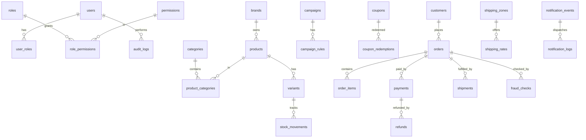

# Project Plan & Architecture

## 1. Architecture Summary

### Core Stack
- **Framework**: Next.js 15 (App Router), React 19, TypeScript (`strict`, `noUncheckedIndexedAccess`, no `any`, no `!`).
- **Database**: PostgreSQL + Drizzle ORM + `drizzle-kit` migrations.
- **Cache & Rate Limiting**: Upstash Redis.
- **Background Jobs / Cron**: Inngest or BullMQ (pending decision in `docs/QUESTIONS.md`).
- **Auth & RBAC**: Better-Auth + dynamic `resource:action` RBAC with Redis permission cache and `super_admin` TOTP MFA.
- **UI**: `@materializecss/materialize` (no Tailwind, no shadcn). Zero client JS on storefront where possible; Materialize JS initialized only on admin components that need it.
- **Validation**: Zod (shared client + server).
- **Integrations (Adapter Pattern)**:
  - Payment: SSLCommerz, bKash (Tokenized), Nagad, COD.
  - Courier: Steadfast, Pathao, RedX.
  - Notifications: Resend (Email), SSL Wireless / BulkSMSBD (SMS), Firebase FCM (Push).
  - Media: Cloudinary / S3 + `next/image`.
- **Testing**: Vitest (unit + integration), Playwright (E2E).

### Layering & Data Flow
Strict unidirectional layering:
`action -> guard -> validate -> service -> db`
- **Server Actions (`actions.ts`)**: Wrapped in `createAction({ permission, schema, rateLimit, handler })`. Returns `ActionResult<T>`, never throws to client. Calls `revalidateTag` after writes and writes `audit_logs` on admin mutations.
- **Services (`service.ts`)**: Pure business logic, never import `next/*`.
- **Queries (`queries.ts`)**: Server-only read layer using RSC + `unstable_cache` / `use cache` + `revalidateTag`. Cursor-based pagination, no `SELECT *`, no N+1.
- **Directory Layout**:
  - `src/app/(store)/` — Public storefront
  - `src/app/(admin)/admin/` — Admin panel
  - `src/app/api/webhooks/{courier,sms,fcm,payment}/route.ts` — Webhook handlers
  - `src/modules/<domain>/` — `schema.ts`, `validators.ts`, `queries.ts`, `actions.ts`, `service.ts`, `types.ts`, `__tests__/`
  - `src/lib/{db,redis,auth,guard,queue,logger,env,errors,money,crypto}.ts`
  - `src/components/{ui,admin,store}/`
  - `src/config/`

### Security Baseline
- `lib/env.ts`: Zod-validated environment variables; no `process.env` reads elsewhere.
- AES-256-GCM encryption at rest for `courier_providers.config_enc` and `payment_providers.config_enc`.
- PII/secrets redaction before writing `audit_logs.diff`, `payments.raw_response`, or logs.
- Payment IPN/webhook double verification (signature + server-side order total match + gateway transaction status API check).
- OAuth auto-link only when `email_verified = true`.
- Media upload server-side re-encoding, MIME allowlist (jpg/png/webp/avif), EXIF stripping.
- Redirects restricted to same-origin relative paths.
- Security headers (CSP, HSTS, X-Content-Type-Options, Referrer-Policy, X-Frame-Options).

---

## 2. Entity-Relationship Diagram (ERD)

Full ERD maintained in [docs/ERD.md](file:///c:/Users/Administrator/Desktop/all-in-one-ecom/docs/ERD.md).

---

## 3. Phase-by-Phase Task Breakdown

### Phase 1: Foundation
- Project scaffolding: Next.js 15, React 19, TypeScript strict, ESLint, Prettier, Vitest, Playwright, `@materializecss/materialize`.
- `lib/env.ts` (Zod env validation), `lib/errors.ts` (`ActionResult`), `lib/logger.ts` (PII redaction), `lib/money.ts` (poisha arithmetic), `lib/crypto.ts` (AES-256-GCM).
- PostgreSQL + Drizzle setup (`lib/db.ts`, `drizzle.config.ts`) + RBAC & Auth schemas (`users`, `roles`, `permissions`, `role_permissions`, `user_roles`, `sessions`, `accounts`, `audit_logs`, `otp_codes`).
- Upstash Redis client + sliding-window rate limiter.
- Better-Auth setup (email/password, Google/Facebook OAuth with `email_verified` check, TOTP MFA, phone OTP).
- Dynamic RBAC service, Redis permission cache, `createAction` wrapper, `<Can perm>` UI guard, route middleware.
- Admin layout shell (Materialize CSS, sidebar, topbar, breadcrumbs, toast/error boundary) + Roles & Permissions CRUD UI + Users management + Audit Log viewer + Seed script.

### Phase 2: Catalog, Media & SEO
- Catalog Drizzle schema (`brands`, `categories`, `products`, `product_categories`, `product_images`, `product_options`, `variants`, `stock_movements`, `reviews`) + SEO schema (`redirects`, `seo_settings`) + FTS GIN index + partial soft-delete indexes.
- Media upload service (MIME allowlist, size limit, sharp re-encode, EXIF strip, Cloudinary/S3 adapter).
- Catalog services & actions: Brands CRUD, Categories tree CRUD (D&D reorder), Shopify-style Product + Option + Variant matrix generator, Stock adjustment & movement log, Redirects (relative path validation) & SEO settings.
- Admin UI for Products (list/create/edit), Categories tree, Brands, Stock management, Redirects & SEO settings.

### Phase 3: Storefront, Cart & Checkout (COD + Gateways)
- Sales & Shipping & Payment Drizzle schemas (`customers`, `addresses`, `carts`, `cart_items`, `orders`, `order_items`, `order_events`, `payment_providers`, `payments`, `refunds`, `shipping_zones`, `shipping_zone_areas`, `shipping_rates`, `shipping_settings`).
- Storefront layout (Materialize CSS, minimal client JS, `next/font`), Home page, Category/Brand listing (cursor pagination, filters, sort), Search (FTS + suggest), PDP (gallery, variant selector, stock indicator, reviews, JSON-LD).
- Cart service & UI (drawer + page, guest session cart, login cart merge).
- Shipping zone matcher service + Admin Shipping Zone CRUD & test tool.
- Checkout Settings Admin UI + Simple Checkout & Advanced Multi-Step Checkout UI + Guest Phone OTP verification + Order Success + Guest->Account conversion + `/track` OTP-gated order tracking.
- Payment Gateway Adapter framework (`sslcommerz`, `bkash`, `nagad`, `cod`) + IPN/callback webhooks + Admin Payment Providers CRUD (encrypted config).
- SEO deliverables: `sitemap.ts`, `robots.ts`, JSON-LD generators, GSC/FB domain verification meta tags.

### Phase 4: Pricing Engine
- Pricing Drizzle schema (`campaigns`, `campaign_targets`, `campaign_rules`, `special_days`, `coupons`, `coupon_targets`, `coupon_redemptions`).
- Pure `PriceEngine` service (`modules/pricing/service.ts`) with 100% unit test coverage (base -> sale_price -> best campaign -> special_day -> coupon -> shipping -> total; half-up rounding, concurrent redemption lock).
- Coupon, Campaign, Special-Day services, actions, and Admin CRUD UIs.
- Cron jobs: `campaign.activate/expire`, `special_day.toggle`.

### Phase 5: Order Management, Courier & Fraud
- Courier & Fraud Drizzle schemas (`courier_providers`, `shipments`, `shipment_events`, `cod_settlements`, `fraud_rules`, `fraud_checks`, `blacklist`, `customer_courier_stats`).
- Order state machine + order edit/cancel/return/restock + Invoice PDF & packing slip + Admin Order bulk actions.
- Fraud scoring engine (rules, weights, thresholds `<30` low, `30-59` medium, `>=60` high `on_hold`) + Admin Fraud Queue, Rules editor, Blacklist CRUD.
- Courier Adapter framework (`steadfast`, `pathao`, `redx`), auto-select + fallback retry queue, tracking webhook, COD settlement reconciliation + Admin Courier UI.

### Phase 6: Notifications & Queue
- Notify Drizzle schema (`notification_events`, `notification_logs`, `push_tokens`).
- Event bus (`emit(type, payload)`), template engine (Handlebars-like vars, Bangla SMS segment calculator), channel adapters (Resend, SSL Wireless/BulkSMSBD, Firebase FCM).
- Retry queue (exponential backoff, max 5) + dead-letter handling + Admin Notification Templates & Delivery Logs UI + User channel preferences.

### Phase 7: Abandon Cart & Marketing
- Marketing Drizzle schema (`segments`, `campaigns_marketing`, `templates`, `referrals`, `tracking_events`, `product_feeds`).
- Abandon cart capture (debounced), `abandon.scan` cron (1h/24h/72h flow, quiet hours 22:00-08:00 Asia/Dhaka, signed `/cart/recover/[token]` + auto `RECOVER-xxxx` coupon).
- Customer segments builder, email/SMS marketing campaigns (A/B subject, throttle, unsubscribe).
- Tracking: GA4, FB Pixel + server-side FB CAPI (dedupe via `event_id`, hashed advanced matching), Google Ads, TikTok Pixel, first/last-touch UTM capture.
- Product feeds (Google Merchant XML, FB Catalog CSV), Referral codes, Wishlist, Back-in-stock alerts, Post-delivery review requests.

### Phase 8: Reports & Dashboards
- Report aggregate tables (`agg_sales_daily`, `agg_product_daily`, `agg_coupon_daily`, `agg_courier_daily`) + `report.aggregate` cron (hourly + nightly full).
- Report services & queries (Sales, Product, Category/Brand, Customer LTV/RFM/Cohort, Coupon ROI, Campaign, Courier perf, Fraud, Abandon recovery, Inventory valuation, Profit, Staff activity) with date-range, period comparison, and CSV/XLSX export.
- Admin Dashboard (KPI cards + sparklines cached 60s) & Reports UI.

### Phase 9: Hardening, Performance & Docs
- Security audit & `pnpm audit` remediation, CSP/HSTS/headers verification, rate-limit & webhook replay verification.
- Performance optimization (`pnpm lighthouse` >= 95 SEO/Perf/A11y, LCP < 2s, CLS < 0.05) + `pnpm rich-results` JSON-LD validator.
- Faker seed script (500 products, 5k orders) + Playwright E2E critical flow tests.
- Final documentation (`README.md`, `.env.example`, `docs/ARCHITECTURE.md`, `docs/RUNBOOK.md`, `docs/API-WEBHOOKS.md`).
